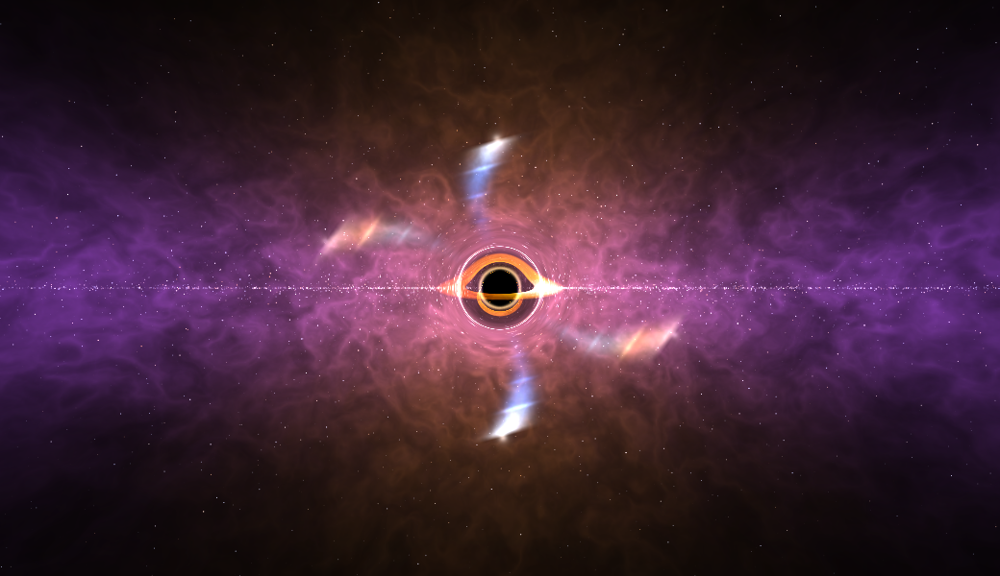

# BinaryConstruct Skybox + Extra Features

This is an independently maintained version of [BinaryConstruct Skybox](https://github.com/BinaryConstruct/skyboxeditor). I used Codex to add features I needed for another project, then shared this version for others to use.

## 8K and 16K exports

Export high-resolution skyboxes as PNG, HDR or EXR. Large exports can stream directly to a folder, and ZIP64 archives support files over 4 GB. See the [export guide](Docs/Instructions/EXPORTS.md) for image sizes and settings.

I tested and used 16K HDR export in Unreal Engine. The other additions remain largely untested, as this side project grew beyond what I needed for my main project.

## Added features

- Placeable, resizable nebula clouds with smoke masks, lighting, shadows and light shafts.
- More galactic band and core controls, with independently editable nebula stacks.
- Native black-hole jet stacks with adjustable size, curves, launch gaps, colors and tips, plus a plumes-only option.
- Undo/redo, layer visibility and drag-and-drop reordering.
- Low-distortion 3D placement, wide and panorama views, preview quality controls and per-item HDR tuning.
- Higher-resolution procedural suns, planets and sprite effects.
- Export UI and smoke seam fixes.



The placement view reduces edge stretching and dragging no longer snaps items to the pointer. Wide views still stretch near the edges. Preview detail can differ from export, and complex nebulae or large lens captures can be slow or exceed GPU memory.

HDR view works throughout editing. Display exposure does not change exports; each item’s HDR emission box controls brightness. Advanced power controls can change visible structure.

HDR/EXR exports default to no added blur. Smoothing and low lens-background detail can soften results; inspect native pixels before export. Larger images cannot recover missing source detail, and oversized source textures are rejected instead of silently reduced.

## Run locally

Requires Node.js 24.

```sh
npm ci
npm run dev
```

Try the `smoke-clouds`, `galactic-rim` or `nebula-jets` presets. See the [usage guide](Docs/Instructions/USAGE.md) for controls.

Use the development server on localhost. To share the editor, build it with `npm run build` and serve `dist/` over HTTPS. See the [hosting guide](Docs/Instructions/HOSTING.md) and [verification guide](Docs/Instructions/VERIFICATION.md).

## Credits

Full attribution is in [CREDITS.md](CREDITS.md). The editor code is [MIT licensed](LICENSE). The bundled HYG star catalog is CC BY-SA 2.5, and the Kenney smoke masks are CC0. See [LICENSING.md](LICENSING.md) for the component terms.
