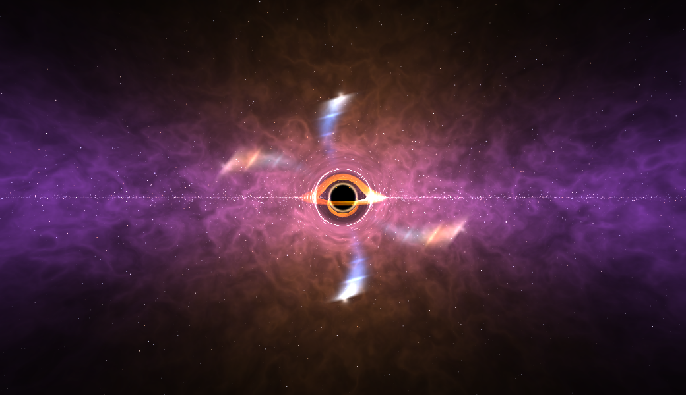

# BinaryConstruct Skybox + Extra Features

I needed extra features for a project I'm working on, so I used Codex to add them to BinaryConstruct Skybox. I'm sharing this version in case anyone else finds it useful.

## 8K and 16K exports

Export high-resolution skyboxes as PNG, HDR or EXR. Large exports can stream directly to a folder, and ZIP64 archives support files over 4 GB. See the [export guide](Docs/Instructions/EXPORTS.md) for image sizes and settings.

I tested and used 16K HDR export in Unreal Engine. The other additions remain largely untested, as this side project grew beyond what I needed for my main project.

## Added features

- Placeable, resizable nebula clouds with smoke masks, lighting, shadows and light shafts.
- More galactic band and core controls, with independently editable nebula stacks.
- Native black-hole jet stacks with adjustable size, curves, launch gaps, colors and tips, plus a plumes-only option.
- Undo/redo, layer visibility and drag-and-drop reordering.
- 2D panorama view, FOV controls, lower-resolution preview settings and HDR smoothness preview.
- Higher-resolution procedural suns, planets and sprite effects.
- Export UI and smoke seam fixes.



## Run locally

Requires Node.js 24.

```sh
npm ci
npm run dev
```

Try the `smoke-clouds`, `galactic-rim` or `nebula-jets` presets. See the [usage guide](Docs/Instructions/USAGE.md) for controls.

## Credits

Original editor: **BinaryConstruct**. Spacescape: **Alex Peterson**. Smoke masks: **Kenney**. Star catalog: **David Nash / Astronomy Nexus**. Full attribution is in [CREDITS.md](CREDITS.md).
